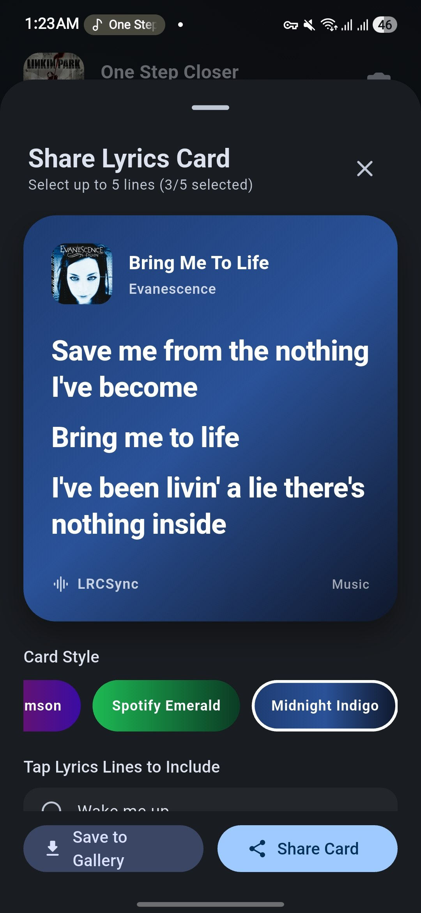

<div align="center">

# 🎵 LRCSync

**Real-time Android Media Session detector & automated `.lrc` lyrics synchronizer built with Flutter and Material You.**

[](https://flutter.dev)
[](https://www.android.com)
[-6750A4)](https://m3.material.io)
[](LICENSE)

</div>

---

## ✨ Overview

**LRCSync** bridges your favorite Android music player (Spotify, YouTube Music, Poweramp, Musicolet, Telegram, Gramophone, Auxio, etc.) with free, community-driven synced lyrics databases (**LRCMux**, **LRCLIB**, and **LRC.red**).

It listens to the active Android `MediaSession` in real time, resolves local audio file paths via `MediaStore` to write `.lrc` files directly beside your songs, and automatically caches lyrics internally for streaming apps—complete with a 60/120fps **Live Lyrics Visualizer** supporting Word-by-Word (`eLRC`), Line-by-Line (`LRC`), and Plain lyrics.

---

## 📸 Screenshots

| Now Playing | Local Library | Batch Downloader | Live Lyrics | Lyrics Card | Settings & Material You |
| :---: | :---: | :---: | :---: | :---: | :---: |
|  |  |  |  |  |  |

---

## 🚀 Features

- **🎧 Real-Time Now Playing & Streaming Support**
  - Reads live metadata (`Title`, `Artist`, `Album`, `Duration`, `Playback Position`, and `Cover Art`) from any active Android media player via `MediaSessionManager` and `NotificationListenerService`.
  - **Local Audio Files**: Automatically resolves the exact file path on your device storage and writes `.lrc` files directly beside the audio file.
  - **Streaming & External Apps (Spotify, YouTube Music, Telegram)**: Automatically stores and loads synced lyrics from LRCSync's internal cache whenever a song without a local file path is played.
- **✨ Live Lyrics Visualizer (Word-by-Word, Line-by-Line & Plain)**
  - **Word-by-Word (`eLRC`)**: Smooth karaoke-style gradient sweep and subtle lift animations synced to individual words/syllables.
  - **Line-by-Line (`LRC`) & Plain**: Auto-scrolling lyrics with smooth scaling transitions and a blurred album art ambient backdrop.
  - **Interactive Playback Controls**: Tap any lyric line (or individual word in Word Sync mode) to seek directly to that timestamp, plus built-in Play/Pause control.
- **📸 Spotify-Style Lyrics Card Generator**
  - Select up to 5 lyric lines from the Live Lyrics screen, choose from custom gradient themes, and save high-resolution PNG cards directly to `Pictures/LRCSync` or share them to social apps.
- **📂 Local Library Browser & Smart Format Detection**
  - Scans and lists all local audio tracks on your device with cached cover art thumbnails, instant search filtering, and smart badges (`eLRC`, `LRC`, or `Plain`) indicating the exact format of existing local lyrics.
- **⚡ One-Tap & Batch `.lrc` Downloading**
  - **Single Track**: Fetch, preview, and automatically save `.lrc` files to storage with zero manual file-picker prompts.
  - **Batch Library Sync**: Download lyrics for your entire music library with configurable request delays (`0.1s` – `5.0s`, with rate-limit warnings) and an option to ignore songs that already have local lyrics.
- **✏️ Inline Query Editor**
  - Quickly edit the **Title**, **Artist**, or **Album** (optional) before or after searching to fix messy ID3 tags or remastered suffixes.
- **🌐 Adjustable Multi-Provider Priority Chain**
  - Supports **[LRCMux](https://lrcmux.dev)** (default), **[LRCLIB](https://lrclib.net)**, and **[LRC.red](https://lrc.red)**. Drag to reorder provider priority in Settings or toggle individual sources to cascade automatically until a match is found.
- **🎨 Material You (Material 3) & AMOLED Dark Mode**
  - Supports Android 12+ dynamic wallpaper colors, custom Material seed palettes, light/dark/system modes, and a pitch-black AMOLED mode.
---

## 🏗️ Architecture

LRCSync uses a feature-first, clean layered architecture paired with a lightweight Kotlin Platform Channel (`MethodChannel` + `EventChannel`) for zero-dependency native Android media integration:

```text
lib/
├── core/
│   ├── settings/       # Theme & Lyrics Provider configuration
│   ├── theme/          # Material 3 Dynamic Color & AMOLED builder
│   └── widgets/        # Shared UI (FloatingNavBar, AlbumArtView)
├── features/
│   ├── now_playing/    # Live MediaSession stream, LyricsService, eLRC parser & TrackCard
│   ├── live_lyrics/    # 60/120fps Word & Line Visualizer + Lyrics Card Screenshot generator
│   ├── library/        # Local MediaStore browser & rate-limited Batch Downloader
│   └── settings/       # Theme customizer, reorderable provider list, cache & permissions
└── main_shell.dart     # Root navigation shell
```
## 🔐 Required Android Permissions
Because LRCSync detects active music from other apps and writes .lrc files directly into your music folders without prompting the system file picker each time, it requests three permissions on first launch:

- ### Notification Listener Access (`BIND_NOTIFICATION_LISTENER_SERVICE`)

Required by Android's MediaSessionManager to read metadata from active media notifications.

- ### Read Media Audio (`READ_MEDIA_AUDIO` / `READ_EXTERNAL_STORAGE`)

Required to query MediaStore.Audio and match the playing song to its local file path and cover art.

- ### All Files Access (`MANAGE_EXTERNAL_STORAGE`)

Required on Android 11+ to silently write non-media .lrc files directly into shared music directories alongside your audio files.

## 🛠️ Getting Started
**Prerequisites**

- Flutter SDK >=3.24.0

- Android Studio / Android SDK (API 26+)

**Installation & Build**
1. Clone the repository

```Bash
git clone https://github.com/mohsenemx/lrcsync.git
cd lrcsync
```
2. Install dependencies

```Bash
flutter pub get
```

3. Run in debug mode

```Bash
flutter run
```
4. Configure Android release signing
To build a signed release APK, you need an Android keystore and a key.properties file.

Follow the official [Flutter guide to creating a keystore and configuring Android app signing](https://docs.flutter.dev/deployment/android#sign-the-app).

Create `android/key.properties` with your signing information:
```properties
storePassword=YOUR_KEYSTORE_PASSWORD
keyPassword=YOUR_KEY_PASSWORD
keyAlias=lrcsync
storeFile=/absolute/path/to/lrcsync-release.jks
```

Replace the placeholder values with your own credentials and the path to your keystore. The keyAlias must match the alias you used when creating the keystore.

**Important**: Keep your keystore and `android/key.properties` private. Never commit them to version control. 
This repository's .gitignore excludes both.

5. Build release APK

```Bash
flutter build apk --release
```

or split into different arch types:

```Bash
flutter build apk --release --split-per-abi
```

## 🤝 Acknowledgements
- [LRCLIB](https://lrclib.net/) for providing a free, open-source crowdsourced synced lyrics API.

- [LRC.red](https://lrc.red) for providing ISRC-matched time-synced .lrc files.

- [LRCMux](https://lrcmux.dev/) for providing best available match across multiple sources.

## 📄 License
This project is licensed under the MIT License — see the `LICENSE` file for details.
